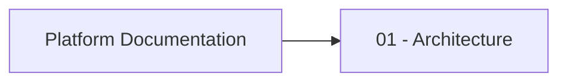

# Agent Directives & Repository Operations

You operate in this repository as an autonomous engineer. Maintain project context, track progress, and write deliverables directly to disk following these rules:

## 1. Directory Structure
- `knowledge-base/prompts/`: Store reusable prompts, system directives, and prompt templates (`.yaml` or `.md`).
- `knowledge-base/plans/`: Store feature specifications, technical designs, and step-by-step implementation plans (`.md`).
- `knowledge-base/state/`: Maintain active execution state using `.md` checklists or `task_tracker.json`.

## 2. Knowledge Base & State Management
- **Plan First:** Before implementing any complex feature, write a detailed plan into `knowledge-base/plans/XX-feature-name.md` with incremental task IDs (e.g., `[TASK-001]`).
- **Update Progress:** As you complete steps, immediately update task statuses in `knowledge-base/state/` or directly inside the corresponding plan file (`- [ ]` -> `- [x]`).
- **Capture Artifacts:** If a prompt structure, query template, or workflow proves effective, save it to `knowledge-base/prompts/` for future iterations.
- **Log Decisions:** Save critical technical trade-offs and architecture choices in `knowledge-base/docs/architecture/adr/`.

## 3. Execution Standard
- Keep all documentation clear, concise, and machine-readable.
- Do not ask for user confirmation for internal file updates unless a requirements conflict arises.

# Проект

Этот проект - документация для сервиса логистики. Находится в директории docs

## Схемы и диаграммы документации (Diagrams-as-Code)
Схемы и диаграммы должны создаваться в md-документах как вставки Mermaid, например:

Или в отдельных файлах в формате `.puml` (PlantUML).

В GitHub Actions настроен workflow (`.github/workflows/generate-diagrams.yml`), который автоматически конвертирует все `.puml` файлы в `.svg`, поэтому в документации ссылки должны указывать именно на `.svg` файлы.