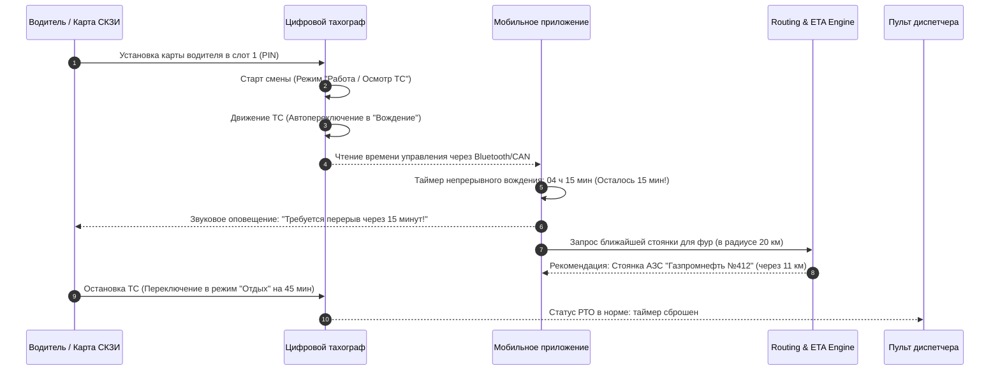

# Режим труда и отдыха водителей (РТО) и тахографический контроль

## 1. Законодательная база и ответственность

Контроль режима труда и отдыха водителей грузового транспорта в РФ регламентируется:
- **Приказом Минтранса России от 16.10.2020 № 424** «Об утверждении Особенностей режима рабочего времени и времени отдыха, условий труда водителей автомобилей».
- **Европейским соглашением о работе экипажей ТС (ЕСТР)** (для международных перевозок).
- **Статьей 11.23 КоАП РФ**:
  - Управление ТС без тахографа или с нарушением норм РТО влечет наложение штрафа: на водителя — до 2 000 ₽; на должностное лицо — до 10 000 ₽; на индивидуального предпринимателя — до 25 000 ₽; на юридическое лицо — **до 50 000 ₽**.

---

## 2. Нормативные лимиты времени (Приказ Минтранса № 424)

| Параметр режима | Предельная норма | Допускаемые исключения |
| :--- | :--- | :--- |
| **Непрерывное управление (Continuous Driving)** | **Не более 4 ч 30 мин** | Превышение до 1 часа допускается только для доезда до ближайшей стоянки |
| **Специальный перерыв (Rest Break)** | **Не менее 45 минут** | Допускается разделение: 1-я часть $\ge 15$ мин, 2-я часть $\ge 30$ мин |
| **Суточное управление (Daily Driving)** | **Не более 9 часов** | Увеличение до 10 часов допускается не более 2 раз в календарную неделю |
| **Еженедельное управление (Weekly Driving)** | **Не более 56 часов** | В течение календарной недели (с 00:00 пн до 24:00 вс) |
| **Управление за 2 недели подряд** | **Не более 90 часов** | Суммарно за любые две последовательные недели |
| **Ежедневный отдых (Daily Rest)** | **Не менее 11 часов подряд** | Допускается сокращение до 9 часов не более 3 раз в неделю с компенсацией |
| **Еженедельный непрерывный отдых** | **Не менее 45 часов** | Допускается сокращение до 24 часов раз в две недели |

---

## 3. Алгоритм вставки стоянок в движок маршрутизации (Routing & ETA Engine)

При расчете маршрута дальнего следования платформа автоматически обогащает граф стоянок:

$$\text{Driving Time} = \frac{L_{\text{distance}}}{V_{\text{avg}}}$$

### Правило разбивки маршрута:
1. **Каждые 4.5 часа чистого хода**:
   - Поиск в радиусе $\pm 25$ км от расчетной точки дорожного сервиса: охраняемой парковки для автопоездов (ТИР-паркинг, Росавтодор, сети АЗС).
   - Вставка фиксированной паузы длительностью **45 минут**.
2. **Каждые 9 часов чистого хода (суточный лимит)**:
   - Вставка точки ночного межсменного отдыха длительностью **11 часов**.
3. **Коррекция ETA для грузовладельца**:
   - Расчетное время прибытия строится строго с учетом пауз РТО:
     $$T_{\text{ETA}} = T_{\text{start}} + T_{\text{drive}} + \sum T_{\text{breaks}} + \sum T_{\text{night\_rest}}$$
   - Это исключает ложные обещания доставки со стороны диспетчера и предотвращает срывы временных окон.

---

## 4. Спецификация считывания данных тахографа (`.ddd` файлы)

Все коммерческие тягачи РФ оснащены тахографами с блоком СКЗИ (НКМ-2.11) или ЕСТР (VDO DTCO, Штрих-Тахо RUS, Атол Drive 5).

### 4.1. Регламент выгрузки данных
- С карты водителя: **не реже 1 раза в 28 календарных дней** (по закону).
- Из памяти тахографа: **не реже 1 раза в 90 дней**.
- Данные хранятся в защищенном архиве платформы в неизменяемом виде не менее 3 лет.

### 4.2. Бинарная структура файла `.ddd` (ASN.1 DER encoding)
Файл содержит криптографически подписанные элементарные файлы (Elementary Files, EF):

| Идентификатор EF | Название секции | Содержимое |
| :--- | :--- | :--- |
| `0x0501` | `EF_Application_Identification` | Версия стандарта тахографа, тип блока СКЗИ |
| `0x0520` | `EF_Identification` | ФИО водителя, номер карты водителя, срок действия |
| `0x0521` | `EF_Driving_Licence_Info` | Серия и номер национального водительского удостоверения |
| `0x0504` | `EF_Driver_Activity_Data` | Хронологический лог смен: тип активности с точностью до минуты |
| `0x0505` | `EF_Events_Data` | Регистрация инцидентов: управление без карты, превышение скорости, отключение питания датчика скорости (ДСП) |

### 4.3. Автоматическая детекция нарушений:
Сервис `fleet-service` при загрузке `.ddd` файла парсит бинарную структуру и генерирует отчет:
- Количество эпизодов превышения 4.5 часов непрерывного хода.
- Сокращения ночного отдыха ниже 9 часов.
- Превышение скорости тягача выше допустимой ограничителем ($> 90$ км/ч).
- Риск выставления штрафа ГИБДД по ст. 11.23 КоАП РФ.
