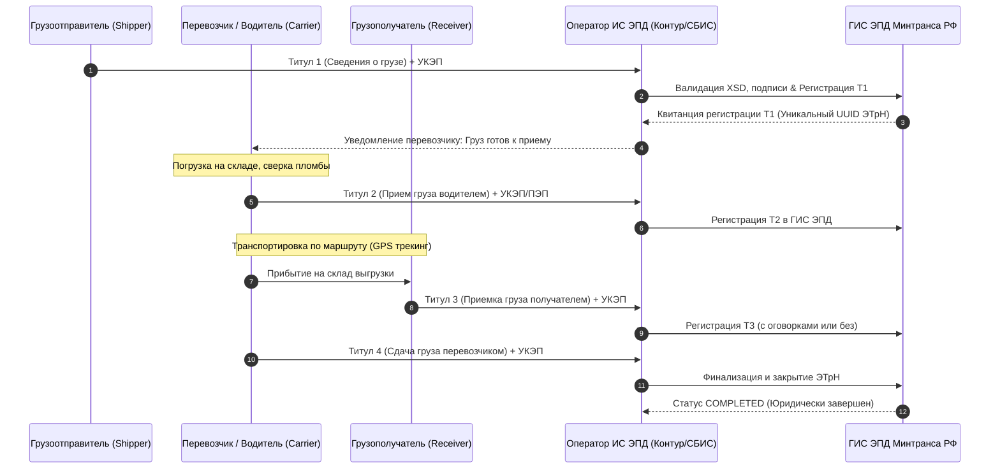

# Электронные перевозочные документы — ЭТрН, ГИС ЭПД и eCMR

## 1. Законодательная база и архитектура ГИС ЭПД

Электронная транспортная накладная (**ЭТрН**) в РФ регулируется:
- Федеральным законом № 259-ФЗ «Устав автомобильного транспорта».
- Постановлением Правительства РФ № 931 от 21.05.2022 (Правила обмена ЭПД).
- Приказами ФНС России № ЕД-7-26/1065@ (Формат ЭТрН 5.01) и № ЕД-7-26/970@ (Формат 5.02).



---

## 2. Спецификация 4 титулов ЭТрН (Формат ФНС XML)

Имя файла формируется по маске: `DP_TRNAKL_<ИдОтпр>_<ИдПолуч>_<Дата>_<GUID>.xml`.

### 2.1. Титул Т1: Сведения грузоотправителя об условиях перевозки
Формируется и подписывается грузоотправителем до выезда машины:
- **Корневой тег**: `<Файл><Документ КНД="1110350">`
- **Обязательные секции**:
  - `<Грузоотпр>`: ИНН, КПП, ОГРН, Юридический адрес.
  - `<Грузополуч>`: Реквизиты получателя.
  - `<Перевозчик>`: Реквизиты автотранспортного предприятия.
  - `<СведГруз>`: Наименование, количество мест, масса брутто (кг), объем (м³), класс опасности ADR, температурный режим.
  - `<ТранспСр>`: Госномер тягача, прицепа, VIN, тип кузова.
  - `<Водитель>`: ФИО, серия/номер водительского удостоверения, СНИЛС.
  - `<Условия>`: Объявленная ценность, сроки доставки, плановые окна погрузки/выгрузки.
- **Подпись**: УКЭП уполномоченного лица грузоотправителя + МЧД.

### 2.2. Титул Т2: Сведения перевозчика о приеме груза
Формируется на складе погрузки после фактической загрузки ТС:
- **Содержание**:
  - Фактическая дата и время подачи ТС под погрузку и убытия.
  - Состояние груза, упаковки, маркировки.
  - Номер установленной пломбы (например, `PL-883190`).
  - Оговорки перевозчика (например: *«Погрузка производилась силами отправителя, без пересчета внутритарных мест»*).
- **Подпись**: Либо УКЭП водителя (с МЧД), либо ПЭП водителя в мобильном приложении с последующей заверкой УКЭП диспетчера автопарка.

### 2.3. Титул Т3: Сведения грузополучателя о приеме груза
Формируется на складе назначения:
- **Содержание**:
  - Фактическое время прибытия ТС и окончания разгрузки.
  - Принятое количество мест и масса брутто.
  - Акт расхождений (при наличии): недостача, бой, порча температурного режима (например: *«Обнаружен задир поддона #4, повреждено 12 упаковок»*).
- **Подпись**: УКЭП кладовщика/товароведа грузополучателя.

### 2.4. Титул Т4: Сведения перевозчика о выдаче груза
Завершающий титул жизненного цикла накладной:
- **Содержание**:
  - Подтверждение сдачи груза и закрытие рейса.
  - Оговорки перевозчика о претензиях (время простоя под выгрузкой сверх норматива для выставления счета за демередж).
- **Подпись**: УКЭП уполномоченного сотрудника перевозчика.

---

## 3. Машиночитаемые доверенности (МЧД) и подписание водителем

В соответствии с требованиями 63-ФЗ с 01.09.2024 при подписании документов сотрудниками от имени юрлица обязательна **МЧД единого формата 003 (EMCHD)**.

### 3.1. Архитектура валидации МЧД:
1. При генерации подписи платформа извлекает `GUID` доверенности из блока `Signature / KeyInfo`.
2. Сервис `document-service` отправляет запрос в ЦПРР ФНС (Единое блокчейн-хранилище доверенностей):
   ```http
   GET /api/v1/mchd/validate?guid=a9182301-bf12-4109-8812-921829012384&inn=7707083893
   ```
3. Проверяется:
   - Статус: `ACTIVE` (не отозвана).
   - Срок действия: `valid_from <= document_date <= valid_to`.
   - Полномочия: Наличие кода полномочия `TRN_SIGN` (Право подписания транспортных накладных).

### 3.2. Сценарии подписания для водителей в рейсе:

| Сценарий | Механизм подписания | Юридическая легитимность |
| :--- | :--- | :--- |
| **Сценарий А (Штатный водитель)** | Личная КЭП физлица на смартфоне (через УЦ «Основание» или «Госключ») + МЧД | Полная автономность, прямое подписание Т2/Т4 в мобильном приложении |
| **Сценарий Б (ПЭП + УКЭП компании)** | Водитель вводит СМС-код ПЭП в приложении $\rightarrow$ формируется протокол ПЭП $\rightarrow$ диспетчер парка ставит УКЭП юрлица | Самый популярный сценарий в РФ (Постановление № 931 разрешает делегирование) |
| **Сценарий В (QR-код для ДПС)** | ГИС ЭПД генерирует динамический QR-код для предъявления инспектору ГИБДД | Проверка через планшет инспектора в офлайн/онлайн режиме базы МВД |

---

## 4. Роуминг операторов ИС ЭПД

Платформа поддерживает открытый роуминг между операторами государственной информационной системы:
- **Прямой шлюз СКБ Контур (Диадок ЭПД)**: gRPC / REST API v2.
- **Прямой шлюз СБИС (Компания «Тензор»)**: REST API.
- **Шлюз АО «Калуга Астрал»**: REST API.

При публикации заказа грузоотправитель указывает своего оператора, а перевозчик — своего. Обмен и квитирование между операторами производится по регламенту Минтранса с гарантированным временем транзита квитанции $\le 30$ секунд.
