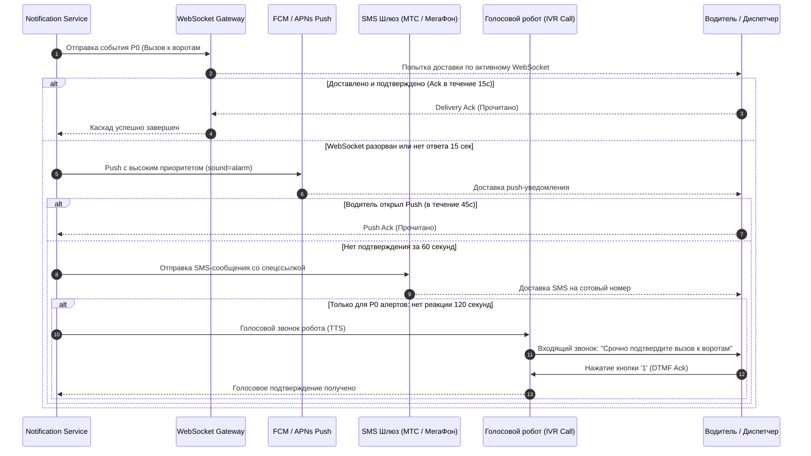

# Каскадный протокол гарантированной доставки уведомлений (Notification Cascades)

## 1. Проблема доставки в магистральной логистике

Водители и экспедиторы находятся в пути: смартфон может быть заблокирован, мобильный интернет 4G может временно отсутствовать, либо водитель занят маневрированием. Одиночный канал (Push или Email) **не обеспечивает гарантии доставки критических событий**.

Для обеспечения 99.99% гарантированной доставки платформа использует **многоуровневый адаптивный каскад (Fallback Cascade)**:



---

## 2. Матрица приоритетов и тайминги каскадов

| Приоритет | Тип событий | Уровни каскада (Timeout цепочки) | Квитирование (Ack) |
| :--- | :--- | :--- | :--- |
| **P0: Emergency / Hot Alert** | Сигнал SOS, ДТП, срыв пломбы, вызов тягача к воротам склада | **WS (0с)** $\rightarrow$ **Push (15с)** $\rightarrow$ **SMS (60с)** $\rightarrow$ **IVR Робот (120с)** | Обязательное подтверждение кликом или DTMF-тоном в звонке |
| **P1: Operational** | Назначение на рейс, отмена бронирования, перебитие ставки на торгах | **WS (0с)** $\rightarrow$ **Push (30с)** $\rightarrow$ **SMS (3 мин)** | Клиентский Ack при получении пакета |
| **P2: Status Update** | Смена статуса ЭТрН, поступление оплаты, факторинговый транш | **WS (0с)** $\rightarrow$ **Push (60с)** $\rightarrow$ **Email дайджест** | Без жесткого таймаута |
| **P3: Informational** | Регулярные отчеты, новости сервиса, рекламные акции | **Email** / In-App Notification Center | Хранение в ленте уведомлений |

---

## 3. Схема данных события уведомления (Notification Envelope)

```json
{
  "notification_id": "notif_91a82f14-bf12-4091-8812-901283901238",
  "recipient_user_id": "usr_550e8400-e29b-41d4-a716-446655440000",
  "recipient_phone": "+79164502211",
  "priority": "P0",
  "event_type": "WAREHOUSE_DOCK_CALLED",
  "title": "Срочно: подача к воротам №4",
  "body": "Тягач А742КХ77 приглашен на разгрузку к пандусу 4. Время на постановку: 15 минут.",
  "payload": {
    "gate_id": 4,
    "trip_id": "trip-12",
    "warehouse_name": "Шушары"
  },
  "cascade_policy": {
    "current_stage": "PUSH",
    "stages": [
      { "channel": "WEBSOCKET", "timeout_sec": 15, "status": "FAILED_TIMEOUT" },
      { "channel": "PUSH", "timeout_sec": 45, "status": "IN_FLIGHT" },
      { "channel": "SMS", "timeout_sec": 60, "status": "PENDING" },
      { "channel": "IVR_CALL", "timeout_sec": 120, "status": "PENDING" }
    ]
  },
  "created_at": "2024-03-20T14:32:00Z"
}
```

---

## 4. Архитектура очереди отложенных событий (Dead-Man's Switch)

Для управления переходами по таймаутам используется **Redis Sorted Sets (ZSET)** в качестве таймер-шедулера:

1. При отправке этапа в ZSET добавляется ключ с оценкой времени:
   ```redis
   ZADD notification_escalation_timers 1710945135 "notif_91a82f14:STAGE_SMS"
   ```
2. Фоновый воркер (`escalation-worker`) непрерывно опрашивает очередь:
   ```redis
   ZRANGEBYSCORE notification_escalation_timers 0 <current_unix_timestamp> LIMIT 0 100
   ```
3. Если за отведенный период от клиента не поступил `POST /api/v1/notifications/{id}/ack`, воркер немедленно инициирует следующий уровень каскада (SMS-отправку или генерацию звонка через Telecom API).
4. При получении Ack таймер удаляется из Redis (`ZREM`), останавливая дальнейшую эскалацию.
