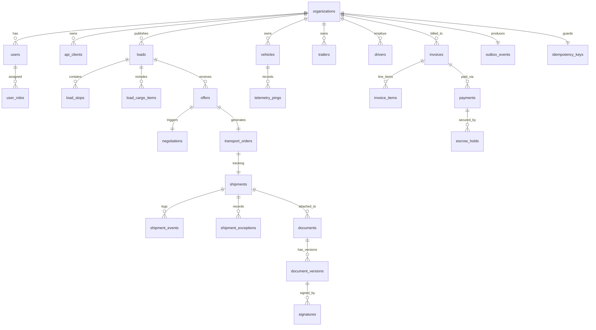

# Полная физическая модель данных и ERD (PostgreSQL & PostGIS)

## 1. Концептуальная диаграмма сущностей (Mermaid ERD)



---

## 2. Физический DDL на PostgreSQL 16 (Production-Grade)

### 2.1 Расширения и перечисления (Extensions & Enums)

```sql
-- Активация необходимых расширений
CREATE EXTENSION IF NOT EXISTS "uuid-ossp";
CREATE EXTENSION IF NOT EXISTS "postgis";
CREATE EXTENSION IF NOT EXISTS "btree_gist";

-- Перечисления статусов
CREATE TYPE load_status_enum AS ENUM (
    'DRAFT', 'MODERATION', 'PUBLISHED', 'UNDER_NEGOTIATION', 
    'BOOKED', 'IN_TRANSIT', 'DELIVERED', 'CANCELLED', 'EXPIRED'
);

CREATE TYPE order_status_enum AS ENUM (
    'CREATED', 'ASSIGNED', 'HEADING_TO_PICKUP', 'AT_PICKUP', 
    'LOADING', 'IN_TRANSIT', 'AT_DELIVERY', 'UNLOADING', 
    'DELIVERED', 'SETTLED', 'CANCELLED', 'DISPUTED'
);

CREATE TYPE body_type_enum AS ENUM (
    'TENT_STANDARD', 'REFRIGERATOR', 'ISOTHERMAL', 
    'FLATBED_OPEN', 'CONTAINER_CARRIER', 'GRAIN_CARRIER'
);
```

---

### 2.2 Ядро маркетплейса: Организации, Грузы, Остановки

```sql
-- 1. Организации (Мульти-тенантность)
CREATE TABLE organizations (
    id UUID PRIMARY KEY DEFAULT gen_random_uuid(),
    inn VARCHAR(12) NOT NULL UNIQUE,
    ogrn VARCHAR(15) NOT NULL,
    kpp VARCHAR(9),
    legal_name VARCHAR(255) NOT NULL,
    trade_name VARCHAR(255),
    is_shipper BOOLEAN NOT NULL DEFAULT false,
    is_carrier BOOLEAN NOT NULL DEFAULT false,
    is_forwarder BOOLEAN NOT NULL DEFAULT false,
    verification_tier VARCHAR(20) NOT NULL DEFAULT 'UNVERIFIED',
    trust_score SMALLINT NOT NULL DEFAULT 50 CHECK (trust_score BETWEEN 0 AND 100),
    created_at TIMESTAMPTZ NOT NULL DEFAULT clock_timestamp(),
    updated_at TIMESTAMPTZ NOT NULL DEFAULT clock_timestamp()
);

CREATE INDEX idx_orgs_inn ON organizations(inn);
CREATE INDEX idx_orgs_trust_score ON organizations(trust_score DESC);

-- 2. Заявки на перевозку (Loads)
CREATE TABLE loads (
    id UUID PRIMARY KEY DEFAULT gen_random_uuid(),
    tenant_id UUID NOT NULL REFERENCES organizations(id) ON DELETE RESTRICT,
    order_number VARCHAR(32) NOT NULL UNIQUE,
    status load_status_enum NOT NULL DEFAULT 'DRAFT',
    
    cargo_title VARCHAR(255) NOT NULL,
    weight_kg INTEGER NOT NULL CHECK (weight_kg > 0),
    volume_m3 NUMERIC(6, 2) NOT NULL CHECK (volume_m3 > 0),
    pallet_count SMALLINT CHECK (pallet_count >= 0),
    body_type body_type_enum NOT NULL,
    temp_min_c SMALLINT,
    temp_max_c SMALLINT,
    
    -- Финансовые условия
    target_rate_cents BIGINT NOT NULL CHECK (target_rate_cents > 0),
    currency VARCHAR(3) NOT NULL DEFAULT 'RUB',
    vat_included BOOLEAN NOT NULL DEFAULT true,
    payment_terms_days SMALLINT NOT NULL DEFAULT 5,
    
    is_private_pool BOOLEAN NOT NULL DEFAULT false,
    allowed_carriers_pool_id UUID,
    
    created_at TIMESTAMPTZ NOT NULL DEFAULT clock_timestamp(),
    updated_at TIMESTAMPTZ NOT NULL DEFAULT clock_timestamp(),
    published_at TIMESTAMPTZ,
    expires_at TIMESTAMPTZ
);

CREATE INDEX idx_loads_tenant_status ON loads(tenant_id, status);
CREATE INDEX idx_loads_status_published ON loads(status) WHERE status = 'PUBLISHED';
CREATE INDEX idx_loads_body_weight ON loads(body_type, weight_kg);

-- 3. Точки маршрута груза (Load Stops) с PostGIS координатами
CREATE TABLE load_stops (
    id UUID PRIMARY KEY DEFAULT gen_random_uuid(),
    load_id UUID NOT NULL REFERENCES loads(id) ON DELETE CASCADE,
    stop_sequence SMALLINT NOT NULL,
    stop_type VARCHAR(20) NOT NULL CHECK (stop_type IN ('PICKUP', 'DELIVERY', 'CUSTOMS')),
    
    address_text TEXT NOT NULL,
    location GEOMETRY(Point, 4326) NOT NULL, -- WGS84 координаты
    geohash VARCHAR(12) NOT NULL,
    
    planned_arrival_from TIMESTAMPTZ NOT NULL,
    planned_arrival_to TIMESTAMPTZ NOT NULL,
    actual_arrival TIMESTAMPTZ,
    actual_departure TIMESTAMPTZ,
    
    contact_name VARCHAR(128),
    contact_phone VARCHAR(32),
    created_at TIMESTAMPTZ NOT NULL DEFAULT clock_timestamp(),
    
    CONSTRAINT uq_load_sequence UNIQUE (load_id, stop_sequence)
);

-- Пространственный индекс PostGIS для мгновенного радиусного поиска грузов
CREATE INDEX idx_load_stops_location_gist ON load_stops USING GIST(location);
CREATE INDEX idx_load_stops_geohash ON load_stops(geohash text_pattern_ops);
```

---

### 2.3 Торги и Транспортные Заказы

```sql
-- 4. Офферы и встречные предложения (Offers)
CREATE TABLE offers (
    id UUID PRIMARY KEY DEFAULT gen_random_uuid(),
    load_id UUID NOT NULL REFERENCES loads(id) ON DELETE RESTRICT,
    carrier_org_id UUID NOT NULL REFERENCES organizations(id) ON DELETE RESTRICT,
    proposed_rate_cents BIGINT NOT NULL CHECK (proposed_rate_cents > 0),
    currency VARCHAR(3) NOT NULL DEFAULT 'RUB',
    status VARCHAR(20) NOT NULL DEFAULT 'SUBMITTED' 
        CHECK (status IN ('SUBMITTED', 'COUNTERED', 'ACCEPTED', 'REJECTED', 'WITHDRAWN')),
    assigned_vehicle_id UUID,
    assigned_driver_id UUID,
    expires_at TIMESTAMPTZ NOT NULL,
    created_at TIMESTAMPTZ NOT NULL DEFAULT clock_timestamp()
);

CREATE INDEX idx_offers_load_status ON offers(load_id, status);
CREATE INDEX idx_offers_carrier ON offers(carrier_org_id, created_at DESC);

-- 5. Транспортный заказ (Transport Orders)
CREATE TABLE transport_orders (
    id UUID PRIMARY KEY DEFAULT gen_random_uuid(),
    order_number VARCHAR(32) NOT NULL UNIQUE,
    load_id UUID NOT NULL REFERENCES loads(id) ON DELETE RESTRICT,
    offer_id UUID NOT NULL REFERENCES offers(id) ON DELETE RESTRICT,
    shipper_org_id UUID NOT NULL REFERENCES organizations(id) ON DELETE RESTRICT,
    carrier_org_id UUID NOT NULL REFERENCES organizations(id) ON DELETE RESTRICT,
    
    status order_status_enum NOT NULL DEFAULT 'CREATED',
    agreed_price_cents BIGINT NOT NULL,
    currency VARCHAR(3) NOT NULL DEFAULT 'RUB',
    
    vehicle_id UUID NOT NULL,
    trailer_id UUID,
    driver_id UUID NOT NULL,
    
    created_at TIMESTAMPTZ NOT NULL DEFAULT clock_timestamp(),
    updated_at TIMESTAMPTZ NOT NULL DEFAULT clock_timestamp()
);

CREATE INDEX idx_orders_shipper ON transport_orders(shipper_org_id, status);
CREATE INDEX idx_orders_carrier ON transport_orders(carrier_org_id, status);
CREATE INDEX idx_orders_vehicle ON transport_orders(vehicle_id);
```

---

### 2.4 Секционированная таблица телеметрии (Timescale / Range Partitioning)

Таблица `telemetry_pings` принимает до 10 000 точек в секунду. В соответствии с **ADR-0002** и **ADR-0009**, она партиционируется по диапазонам дат (`RANGE (timestamp)`):

```sql
CREATE TABLE telemetry_pings (
    device_id VARCHAR(64) NOT NULL,
    vehicle_id UUID NOT NULL,
    timestamp TIMESTAMPTZ NOT NULL,
    location GEOMETRY(Point, 4326) NOT NULL,
    speed_kmh REAL NOT NULL,
    course_degrees REAL NOT NULL,
    altitude_m REAL,
    satellites_count SMALLINT,
    fuel_level_percent REAL,
    cargo_temp_c REAL,
    is_engine_on BOOLEAN NOT NULL DEFAULT true,
    is_moving BOOLEAN NOT NULL DEFAULT true,
    
    PRIMARY KEY (vehicle_id, timestamp)
) PARTITION BY RANGE (timestamp);

-- Создание помесячных партиций (пример)
CREATE TABLE telemetry_pings_2026_11 PARTITION OF telemetry_pings
    FOR VALUES FROM ('2026-11-01 00:00:00+00') TO ('2026-12-01 00:00:00+00');

CREATE TABLE telemetry_pings_2026_12 PARTITION OF telemetry_pings
    FOR VALUES FROM ('2026-12-01 00:00:00+00') TO ('2027-01-01 00:00:00+00');

-- Индексы на партициях
CREATE INDEX idx_telemetry_vehicle_time ON telemetry_pings(vehicle_id, timestamp DESC);
CREATE INDEX idx_telemetry_location_gist ON telemetry_pings USING GIST(location);
```

---

### 2.5 Надежность: Transactional Outbox & Распределенная идемпотентность

В соответствии с **ADR-0011 (Transactional Outbox)** и **ADR-0012 (Distributed Idempotency)**:

```sql
-- Таблица транзакционного Outbox (Гарантия Exactly-Once генерации событий)
CREATE TABLE outbox_events (
    id UUID PRIMARY KEY DEFAULT gen_random_uuid(),
    aggregate_type VARCHAR(64) NOT NULL, -- 'Load', 'Order', 'Payment'
    aggregate_id VARCHAR(64) NOT NULL,
    event_type VARCHAR(128) NOT NULL,    -- 'LoadPublished', 'OrderAssigned'
    payload JSONB NOT NULL,              -- Тело события в CloudEvents / JSON формате
    trace_id VARCHAR(64) NOT NULL,       -- W3C Trace Context
    status VARCHAR(20) NOT NULL DEFAULT 'PENDING' CHECK (status IN ('PENDING', 'PROCESSED', 'FAILED')),
    retry_count SMALLINT NOT NULL DEFAULT 0,
    created_at TIMESTAMPTZ NOT NULL DEFAULT clock_timestamp(),
    processed_at TIMESTAMPTZ
);

-- Индекс для высокоскоростного Debezium / Poller опроса только ожидающих сообщений
CREATE INDEX idx_outbox_pending ON outbox_events(created_at) WHERE status = 'PENDING';

-- Таблица распределенной идемпотентности
CREATE TABLE idempotency_keys (
    key VARCHAR(255) PRIMARY KEY,
    user_id UUID NOT NULL,
    organization_id UUID NOT NULL,
    request_hash VARCHAR(64) NOT NULL,
    response_code INTEGER NOT NULL,
    response_body JSONB NOT NULL,
    created_at TIMESTAMPTZ NOT NULL DEFAULT clock_timestamp(),
    expires_at TIMESTAMPTZ NOT NULL
);

CREATE INDEX idx_idempotency_expires ON idempotency_keys(expires_at);
```

---

## 3. Политики изоляции тенантов (Row-Level Security)

Для соответствия **ADR-0008 (Multi-Tenancy)** включается механизм RLS на критических таблицах:

```sql
-- Активация RLS
ALTER TABLE loads ENABLE ROW LEVEL SECURITY;
ALTER TABLE transport_orders ENABLE ROW LEVEL SECURITY;

-- Политика: Организация видит только свои грузы (если не публичные)
CREATE POLICY tenant_isolation_loads ON loads
    FOR ALL
    USING (
        tenant_id = NULLIF(current_setting('app.current_tenant_id', true), '')::UUID 
        OR status = 'PUBLISHED'
    );
```
