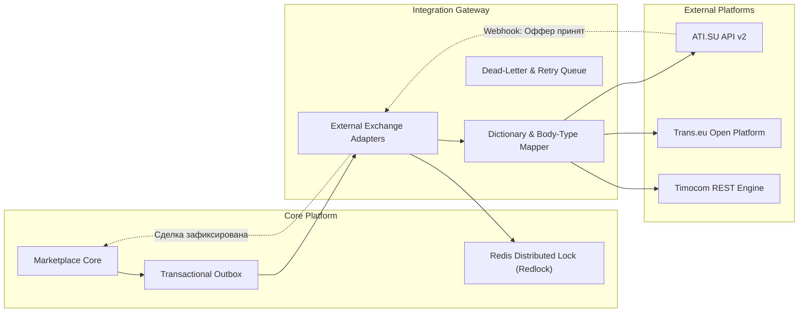

# Интеграционный гайд: Внешние биржи и маркетплейсы грузоперевозок

## 1. Назначение интеграции
Интеграционный шлюз **External Marketplaces Gateway** обеспечивает двусторонний обмен данными (синдикацию) между платформой и внешними логистическими биржами (ATI.SU, Trans.eu, Timocom, Wtransnet, Teleroute).

Ключевые возможности:
- **Кросс-листинг грузов**: автоматическая публикация излишков грузов наших клиентов на внешние биржи при отсутствии внутренних перевозчиков.
- **Импорт внешних предложений транспорта**: агрегация свободных тягачей партнеров для покрытия пиковых нагрузок.
- **Защита от двойного бронирования (Double Booking Prevention)**: мгновенный отзыв заявки со всех внешних площадок при заключении сделки внутри платформы.
- **Нормализация справочников**: кросс-маппинг типов кузовов, условий погрузки (боковая/верхняя) и температурных режимов.

---

## 2. Архитектура взаимодействия



---

## 3. Таблица маппинга типов подвижного состава

| Внутренний код кузова | Описание | Код в ATI.SU | Код в Trans.eu | Код в Timocom |
| :--- | :--- | :--- | :--- | :--- |
| `TENT_STANDARD` | Полуприцеп тентованный, 13.6м, 82-92 м³, до 20т | `1` (Тент) | `CURTAIN_SIDER` | `PLANENAUFLIEGER` |
| `REFRIGERATOR` | Рефрижератор FRC (-20°C..+12°C), термописец | `2` (Рефрижератор) | `REEFER` | `KUHLKOFFER` |
| `ISOTHERMAL` | Изотермический фургон | `3` (Изотерм) | `INSULATED_BOX` | `ISOKOFFER` |
| `FLATBED_OPEN` | Открытая бортовая платформа | `4` (Бортовой/Открытый) | `FLATBED` | `OFFENER_KASTEN` |
| `CONTAINER_CARRIER`| Контейнеровоз (20ft / 40ft High Cube) | `7` (Контейнеровоз) | `CONTAINER_CHASSIS` | `CONTAINERCHASSIS` |
| `GRAIN_CARRIER` | Зерновоз самосвальный | `15` (Зерновоз) | `BULK_GRAIN` | `KIPP_SILO` |

---

## 4. Защита от коллизий и двойного бронирования (Double Booking Prevention)

Для предотвращения ситуации, когда один и тот же рейс или груз бронируется одновременно на внутренней бирже и на внешнем агрегаторе, применяется паттерн **Distributed Pessimistic Locking с таймаутом**:

1. При поступлении сигнала о бронировании (`AcceptOfferCommand`) сервис захватывает ключ в Redis Cluster:
   ```
   SET lock:load:{load_id} {uuid} NX PX 15000
   ```
2. Если ключ успешно захвачен:
   - В локальной БД статус груза атомарно переводится в `BOOKED`.
   - В топик `external.syndication.withdraw.v1` отправляется событие мгновенного отзыва.
   - Адаптеры параллельно вызывают DELETE методы на внешних биржах:
     - `DELETE https://api.ati.su/v1.0/loads/{ati_load_id}`
     - `DELETE https://api.trans.eu/v2/offers/{trans_offer_id}`
3. Если внешняя биржа ответила, что груз уже был забронирован на их стороне за микросекунды до этого:
   - Срабатывает компенсационная транзакция (Saga Compensating Action): локальный статус возвращается, пользователю выводится уведомление о коллизии, инициируется подбор альтернативного рейса.

---

## 5. Формат запроса на публикацию груза во внешнюю биржу

```http
POST /api/v1/integrations/external/loads/syndicate HTTP/1.1
Host: api.cargo-platform.example.com
Authorization: Bearer <internal_gateway_token>
Content-Type: application/json

{
  "load_id": "load_0019283fa710",
  "target_platforms": ["ATI_SU", "TRANS_EU"],
  "route": {
    "from_kladr_id": "7700000000000",
    "from_city": "Москва",
    "from_coordinates": { "lat": 55.7558, "lng": 37.6173 },
    "to_kladr_id": "6600000100000",
    "to_city": "Екатеринбург",
    "to_coordinates": { "lat": 56.8389, "lng": 60.6057 },
    "distance_km": 1780
  },
  "cargo": {
    "name": "Промышленное оборудование",
    "weight_kg": 19500,
    "volume_m3": 82.0,
    "body_type": "TENT_STANDARD",
    "loading_types": ["TOP", "SIDE", "REAR"]
  },
  "pricing": {
    "published_rate_cents": 14500000,
    "currency": "RUB",
    "payment_terms_days": 5,
    "vat_included": true
  },
  "contact": {
    "dispatcher_name": "Единый диспетчерский центр",
    "phone": "+74951234567"
  }
}
```

### Ответ адаптера

```http
HTTP/1.1 200 OK
Content-Type: application/json

{
  "syndication_id": "syn_882910fa-1123",
  "load_id": "load_0019283fa710",
  "status": "PARTIALLY_PUBLISHED",
  "platforms": {
    "ATI_SU": {
      "status": "ACTIVE",
      "external_id": "ati_load_9182371",
      "published_at": "2026-11-09T13:28:10Z",
      "url": "https://loads.ati.su/load/9182371"
    },
    "TRANS_EU": {
      "status": "PENDING_VALIDATION",
      "external_id": "trans_offer_1192841",
      "published_at": "2026-11-09T13:28:12Z"
    }
  }
}
```

---

## 6. Мониторинг и метрики надежности шлюза
В Prometheus экспортируются метрики:
- `external_syndication_requests_total{platform, status}`
- `external_syndication_withdrawal_duration_seconds{platform}` (P99 < 800ms для исключения коллизий)
- `external_syndication_double_booking_conflicts_total` (целевой SLO = 0).
