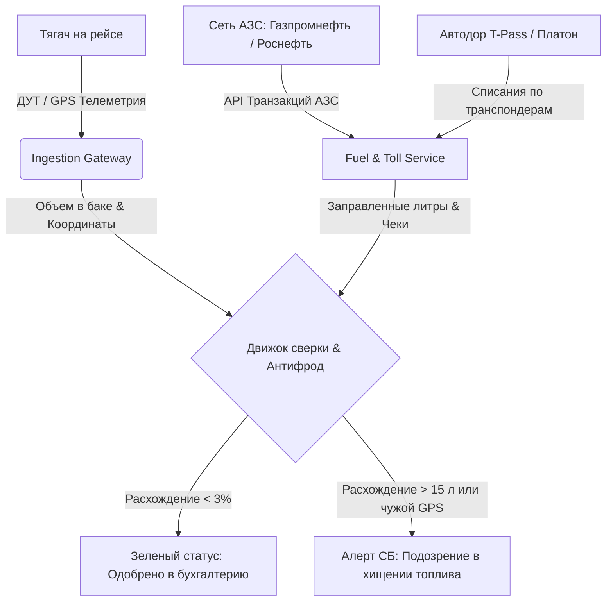

# Интеграция с топливными процессингами и системами оплаты дорог (Fuel & Tolls Integration)

## 1. Контекст и бизнес-цели

Топливо и оплата дорог составляют **до 52% операционных расходов (OPEX)** магистрального автопарка в России. Автоматическая интеграция позволяет:
1. Исключить ручной сбор бумажных чеков водителей на АЗС.
2. Проводить мгновенную сверку данных датчиков уровня топлива (ДУТ) с чеками АЗС для пресечения сливов и заправок «налево».
3. Автоматически списывать дорожные сборы (Автодор, ЦКАД «Свободный поток», «Платон») и относить их на себестоимость конкретного заказа.



---

## 2. Интеграция с топливными компаниями (Fuel Cards API)

Платформа поддерживает работу со шлюзами трех крупнейших эмитентов топливных карт в РФ:
- **Газпромнефть (ОПТИ 24 API)**: REST API с OAuth2 аутентификацией.
- **Роснефть (РН-Карт API)**: SOAP / REST шлюз корпоративного кабинета.
- **ППР (Передовые Платежные Решения / Петрол Плюс)**: Универсальный шлюз мультибрендовых карт.

### 2.1. Формат нормализованной транзакции АЗС (`FuelTransaction`)

```json
{
  "transaction_id": "tx_gpn_991823019284",
  "card_number": "7005120019284012",
  "vehicle_id": "00000000-0000-0000-0004-000000000001",
  "driver_id": "00000000-0000-0000-0003-000000000001",
  "order_id": "00000000-0000-0000-0006-000000000001",
  "timestamp": "2024-03-20T14:15:30Z",
  "station_brand": "Газпромнефть № 412",
  "station_address": "Трасса М-11 Нева, 258-й км (Тверская обл.)",
  "location": {
    "lat": 57.129412,
    "lon": 34.891244
  },
  "fuel_type": "DIESEL_EURO_5",
  "liters_dispensed": 450.0,
  "price_per_liter_rub": 64.50,
  "total_amount_rub": 29025.00,
  "currency": "RUB"
}
```

---

## 3. Алгоритм антифрода и сверки с датчиком уровня топлива (ДУТ)

Бортовой трекер через RS-485 опрашивает емкостной высокоточный датчик уровня топлива (Omnicomm / Стрела) с шагом 5 секунд.

### Формула детекции хищений (Discrepancy Formula):

$$\Delta V = V_{\text{dispensed\_station}} - \left( V_{\text{tank\_after}} - V_{\text{tank\_before}} \right)$$

1. **Проверка геопривязки (Geofence Check)**:
   - Вычисляется расстояние между координатами АЗС в чеке и GPS-координатами тягача в момент времени `timestamp`:
     $$D = \text{Haversine}(\text{Point}_{\text{truck}}, \text{Point}_{\text{station}})$$
   - Если $D > 250$ метров $\rightarrow$ **P0 Fraud Incident: Физическое отсутствие ТС на АЗС (заправка чужой машины по корпоративной карте)**.
2. **Проверка объема (Liters Mismatch)**:
   - Допустимая погрешность емкостного ДУТ при уклоне тягача: $\pm 3\%$.
   - Если $\Delta V > 15$ литров $\rightarrow$ **P1 Alert: Недолив или заправка в скрытую канистру**.

---

## 4. Платные дороги: «Автодор — Платные Дороги» и ЦКАД

### 4.1. Транспондеры T-Pass (DSRC 5.8 GHz)
- Каждый тягач автопарка привязан к серийному номеру транспондера (PAN: `000000000000...`).
- Сервис `tolls-service` каждые 30 минут синхронизирует детализацию проездов через API ООО «Автодор-Платные Дороги».
- Автоматически применяется скидка программы лояльности (до 15%).

### 4.2. Система безбарьерной оплаты «Свободный поток» (Free-Flow)
На автомагистралях ЦКАД и М-12 «Восток» отсутствуют классические пункты оплаты со шлагбаумами:
- Камеры распознают госномер тягача на скорости до 130 км/ч.
- Платформа напрямую подключена к шлюзу постоплаты: списания производятся безакцептно с единого корпоративного лицевого счета, предотвращая административные штрафы Ространснадзора (ст. 12.21.4 КоАП РФ).

---

## 5. Государственная система взимания платы «Платон»

Для тяжеловесных ТС (разрешенная максимальная масса $> 12$ тонн):
- **Нормативная ставка**: **3.05 ₽ за 1 км** пробега по автомобильным дорогам общего пользования федерального значения.
- **Интеграция**:
  - Прямой обмен через SOAP API ФДА «Росавтодор» / РТ-Инвест Транспортные Системы.
  - Контроль наличия средств на лицевом счете бортового устройства (БУ).
  - При неисправности БУ сервис автоматически оформляет электронную Маршрутную карту до выезда в рейс.
- **Предотвращение штрафов**: При риске нулевого баланса во время рейса диспетчер получает алерт за 50 км до исчерпания средств.
