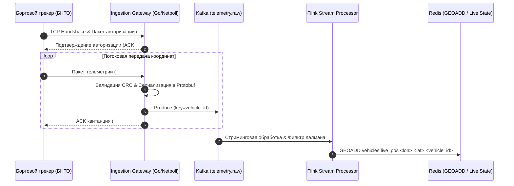

# Интеграция с телематическими системами и аппаратными трекерами (Hardware Telematics Protocol Specification)

## 1. Архитектура контура приема телематики

Контур телематики (`telemetry-ingestion-gateway`) спроектирован для удержания сотен тысяч одновременных TCP/UDP-сессий от бортовых навигационных блоков (БНТО, тахографов, трекеров) и серверов ретрансляции.



---

## 2. Поддерживаемые протоколы и сетевые порты

| Протокол | Транспорт | Порт по умолчанию | Описание и сфера применения |
| :--- | :--- | :--- | :--- |
| **Wialon IPS v2.0** | TCP / UDP | `20100` | Самый распространенный открытый протокол (Navtelecom, Arnavi, BCE) |
| **EGTS (ГОСТ 33472-2015)**| TCP | `20200` | Государственный стандарт РФ (ЭРА-ГЛОНАСС, АСУ Навигация) |
| **Teltonika Codec 8/8E** | TCP | `20300` | Трекеры серии FMB (FMB920, FMB125, FMB640 с чтением CAN-шины) |
| **Galileosky v5.0** | TCP | `20400` | Профессиональные терминалы с поддержкой CAN-LOG и термокос |
| **HTTP Batch Ingestion** | HTTPS REST | `443` (`/api/v1/telemetry/batch`) | Мобильное приложение водителя (Offline-First sync) |

---

## 3. Протокол Wialon IPS v2.0 (Спецификация парсинга)

Текстовый протокол с разделителем полей `;` и завершением строки `\r\n`.

### 3.1. Пакет авторизации трекера (`#L#`)
```text
#L#2.0;IMEI;PASSWORD;CRC16\r\n
```
*Пример:*
```text
#L#2.0;861928301928401;NA;4B2A\r\n
```
- Gateway проверяет `IMEI` по реестру ТС (`vehicles.telematics_imei`).
- **Ответ шлюза (ACK):**
  - При успехе: `#AL#1\r\n`
  - Ошибка авторизации (неизвестный IMEI): `#AL#0\r\n` (соединение разрывается).

### 3.2. Пакет одиночной навигационной точки (`#D#`)
```text
#D#DATE;TIME;LAT1;LAT2;LON1;LON2;SPEED;COURSE;ALT;SATS;HDOP;INPUTS;OUTPUTS;ADC;IBUTTON;PARAMS;CRC16\r\n
```
*Пример реального пакета:*
```text
#D#200324;143015;5545.1234;N;03737.5678;E;78;142;185;14;1.2;3;0;12.6,0.0;0;pwr_ext:1:24.4,can_fuel_level:1:78,temp_reefer:2:-18.5;F3A1\r\n
```

**Правила декодирования координат (NMEA DDMM.MMMM в WGS84):**
$$\text{Lat}_{\text{deg}} = \text{DD} + \frac{\text{MM.MMMM}}{60}$$
Если `LAT2 == 'S'`, значение умножается на $-1$.
$$\text{Lon}_{\text{deg}} = \text{DDD} + \frac{\text{MM.MMMM}}{60}$$
Если `LON2 == 'W'`, значение умножается на $-1$.

- **Ответ шлюза (ACK):** `#AD#1\r\n` (или `#AD#-1\r\n` при ошибке CRC).

### 3.3. Пакет черного ящика (`#B#`) — восстановление оффлайн-трека
Отправляется трекером при выезде из зоны радиомолчания. Содержит несколько навигационных записей, разделенных символом `|`:
```text
#B#DATE;TIME;...|DATE;TIME;...|DATE;TIME;...;CRC16\r\n
```
- **Ответ шлюза (ACK):** `#AB#<количество_принятых_точек>\r\n` (например, `#AB#42\r\n`).

---

## 4. Протокол EGTS (ГОСТ 33472-2015 / ЭРА-ГЛОНАСС)

Бинарный пакетный протокол с разделением на транспортный (Transport Layer) и прикладной (Service Layer) уровни.

### 4.1. Структура транспортного заголовка (Transport Header)
```
+---+---+---+---+---+---+---+---+---+---+---+
|PRV|SKID|PRF|RTE|ENA|CMP|PR |HL |HE |FDL|PID|
| 1B| 1B |       1B          | 1B| 1B| 2B| 2B|
+---+---+---+---+---+---+---+---+---+---+---+
|PT |PRA|RCA|      HCS      |
| 1B| 2B| 2B|       1B      |
+---+---+---+---------------+
```
- `PRV` (Protocol Version): `0x01`.
- `HL` (Header Length): `11` байт (без роутинга) или `16` байт (с `PRA`/`RCA`).
- `HCS` (Header Checksum): CRC-8 (полином $x^8 + x^5 + x^4 + 1$, начальное значение `0xFF`).

### 4.2. Полезная нагрузка подсистемы позиционирования (`EGTS_SR_POS_DATA`)
| Поле | Байт | Тип | Описание |
| :--- | :--- | :--- | :--- |
| `NTM` | 4 | `uint32` | Навигационное время (секунды с 00:00:00 01.01.2010 UTC) |
| `LAT` | 4 | `uint32` | Широта: $\text{Lat} = \frac{\text{VAL} \times 90}{0xFFFFFFFF}$ |
| `LONG` | 4 | `uint32` | Долгота: $\text{Lon} = \frac{\text{VAL} \times 180}{0xFFFFFFFF}$ |
| `FLAGS` | 1 | `uint8` | Битовые флаги: VLD (валидность), ALTE, MV (движение) |
| `SPD` | 2 | `uint14` | Скорость ТС в десятых долях км/ч ($0.1 \times \text{SPD}$) |
| `DIR` | 1 | `uint9` | Направление движения / Курс ($0..360^\circ$) |
| `ODM` | 3 | `uint24` | Пробег ТС (одометр) в сотнях метров |

### 4.3. Алгоритм контрольных сумм
- **Заголовок (HCS):** CRC-8 табличный алгоритм (CRC-8-Dallas/Maxim).
- **Данные (SFRCS):** CRC-16-CCITT (полином `0x1021`, начальное значение `0xFFFF`).

---

## 5. Протокол Teltonika Codec 8 / Codec 8 Extended

Бинарный формат, передаваемый трекерами Teltonika:

```
[4 Bytes Zero Preamble] -> [4 Bytes Data Length] -> [1 Byte Codec ID (0x08)] -> 
[1 Byte Number of Data 1] -> [AVL Data Record Array] -> [1 Byte Number of Data 2] -> 
[4 Bytes CRC-16]
```

### Структура одной записи AVL Data:
1. **Timestamp**: 8 байт (`uint64`, миллисекунды UNIX UTC).
2. **Priority**: 1 байт (`0` = Low, `1` = High, `2` = Panic/SOS).
3. **GPS Element**:
   - `Longitude`: 4 байта (`int32`, делить на $10^7$).
   - `Latitude`: 4 байта (`int32`, делить на $10^7$).
   - `Altitude`: 2 байта (`int16`, метры).
   - `Angle`: 2 байта (`uint16`, градусы).
   - `Satellites`: 1 байт.
   - `Speed`: 2 байта (`uint16`, км/ч).
4. **IO Element (CAN-данные)**:
   - ID 9: Уровень топлива в основном баке (в литрах или %).
   - ID 16: Нагрузка на ось (Axle weight kg).
   - ID 72: Температура терморегистратора рефрижератора ХОУ (°C).
   - ID 239: Статус зажигания (Ignition ON/OFF).

- **Ответ сервера (ACK):** 4 байта с количеством успешно записанных точек: `uint32(numberOfData)`.

---

## 6. Фильтрация и нормализация в Kafka

Все входящие пакеты нормализуются шлюзом в единую схему CloudEvents v1.0 и публикуются в Kafka топик `telemetry.raw`:

```json
{
  "specversion": "1.0",
  "type": "cargo.telemetry.ping.v1",
  "source": "ingestion://wialon-gw-01",
  "id": "ping_9a823b12-4210-4491-bf12-921829012384",
  "time": "2024-03-20T14:30:15.210Z",
  "datacontenttype": "application/json",
  "data": {
    "vehicle_id": "00000000-0000-0000-0004-000000000001",
    "imei": "861928301928401",
    "latitude": 55.751234,
    "longitude": 37.618912,
    "speed_kmh": 78.4,
    "course": 142.0,
    "altitude_m": 185,
    "satellites": 14,
    "hdop": 1.2,
    "sensors": {
      "ignition": true,
      "fuel_level_liters": 420.5,
      "reefer_temp_celsius": -18.5,
      "axle_load_kg": 11500
    },
    "device_timestamp": "2024-03-20T14:30:15Z",
    "server_ingested_at": "2024-03-20T14:30:15.210Z"
  }
}
```

### Правила санитарной очистки данных (Stream Sanitation):
1. **Отсечение выбросов (Jumps)**: Если расстояние между соседними точками $> 5$ км при времени $\Delta t < 60$ с (скорость $> 300$ км/ч) $\rightarrow$ точка отбрасывается как GPS Glitch.
2. **Нулевые координаты**: Координаты `(0.0, 0.0)` автоматически блокируются.
3. **HDOP фильтр**: Если $\text{HDOP} > 3.0$ или количество спутников $< 4$, флаг валидности устанавливается в `is_navigation_valid = false`.
