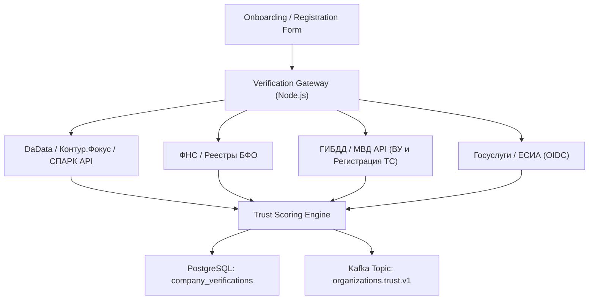

# Интеграционный гайд: Верификация и скоринг участников (KYC / KYB)

## 1. Назначение сервиса
Модуль **Identity & Trust Verification** обеспечивает проверку благонадежности всех участников платформы: грузовладельцев, транспортных компаний, частных перевозчиков и водителей до их допуска к торгам, распределению заказов и финансовым расчетам.

Интеграция решает задачи:
- Исключение мошенников, фирм-однодневок и посредников-клонов («каруселей»).
- Валидация правоспособности юридических лиц и ИП в режиме реального времени.
- Проверка действительности водительских удостоверений и диагностических карт ТС.
- Расчет динамического рейтинга надежности (**Trust Score** 0..100) и присвоение бейджей доверия.

---

## 2. Архитектура интеграционного шлюза



---

## 3. Внешние поставщики данных

| Провайдер | Назначение | Протокол | Частота проверки |
| :--- | :--- | :--- | :--- |
| **DaData / Dadata Company** | Нормализация реквизитов по ИНН, статус ЕГРЮЛ/ЕГРИП, адрес регистрации | REST / HTTPS JSON | При регистрации + раз в 30 дней |
| **СПАРК-Интерфакс / Контур.Фокус** | Арбитражные дела, исполнительные производства (ФССП), риск банкротства, финансовая отчетность | SOAP / REST XML/JSON | При регистрации + регулярный мониторинг |
| **Сервисы ГИБДД** | Проверка лишения водительских прав, розыска и ограничений на тягач/полуприцеп | REST Proxy | При добавлении водителя/ТС и перед каждым назначением на рейс |
| **Госуслуги (ЕСИА)** | Подтверждение личности водителя и самозанятого, квалифицированная подпись (КЭП) | OpenID Connect (OAuth2) | Однократно при авторизации |

---

## 4. Алгоритм скоринга благонадежности (Trust Score)

Формула расчета базового скоринга организации:

$$\text{TrustScore} = w_1 \cdot S_{\text{legal}} + w_2 \cdot S_{\text{finance}} + w_3 \cdot S_{\text{reputation}} + w_4 \cdot S_{\text{fleet}} - P_{\text{risk}}$$

Где весовые коэффициенты:
- $w_1 = 0.30$ (Юридическая чистота): срок жизни юрлица > 1 года (+15), отсутствие в реестре массовых директоров (+10), совпадение фактического адреса (+5).
- $w_2 = 0.25$ (Финансовое здоровье): отсутствие блокировок счетов по 115-ФЗ, размер уставного капитала, выручка по данным БФО.
- $w_3 = 0.25$ (История на платформе): процент успешных достановок, отсутствие опозданий, средняя оценка диспетчеров.
- $w_4 = 0.20$ (Подтвержденный автопарк): наличие собственных или лизинговых ТС, подтвержденные телематические трекеры.
- $P_{\text{risk}}$ (Штрафные баллы): открытые арбитражные иски с суммой претензий > 1 000 000 ₽ (-25), судебные дела по ст. 159 УК РФ (-100, мгновенная блокировка).

### Уровни доступа (Verification Tiers)

```
[ UNVERIFIED ]  -> Только просмотр публичных грузов, торги заблокированы
       │
[ BRONZE ]      -> Доступны заказы с постоплатой до 100 000 ₽
       │
[ SILVER ]      -> Стандартный доступ: заказы до 500 000 ₽, факторинг
       │
[ GOLD ]        -> Неограниченные объемы, допуск в приватные пулы корпоративных грузовладельцев
```

---

## 5. Формат обмена данными

### Запрос на скоринг компании

```http
POST /api/v1/verification/organizations/scoring HTTP/1.1
Host: api.cargo-platform.example.com
Authorization: Bearer <service_token>
Content-Type: application/json

{
  "organization_id": "org_7f8a92d1",
  "inn": "7707083893",
  "kpp": "773601001",
  "ogrn": "1027700132195",
  "company_name": "ООО ТРАНС-ЛОГИСТИК ЦЕНТР",
  "ceo_inn": "772390184421",
  "is_carrier": true,
  "declared_fleet_size": 18
}
```

### Ответ сервиса скоринга

```http
HTTP/1.1 200 OK
Content-Type: application/json

{
  "verification_id": "ver_91a02bce-514d-4567-b892-0019283fa710",
  "organization_id": "org_7f8a92d1",
  "status": "APPROVED",
  "tier": "SILVER",
  "trust_score": 84,
  "checks": {
    "egrul_active": true,
    "registration_age_days": 1420,
    "bankruptcy_signals": false,
    "mass_director": false,
    "fssp_debts_total_cents": 0,
    "tax_debts_active": false,
    "court_cases_active_count": 1,
    "court_cases_total_risk_cents": 12000000
  },
  "recommendations": [
    "Допущен к перевозкам со стандартной страховкой",
    "Для перехода в статус GOLD требуется подключить прямую телеметрию Wialon/Omnicomm к 100% автопарка"
  ],
  "verified_at": "2026-11-09T13:25:00Z",
  "expires_at": "2026-12-09T13:25:00Z"
}
```

---

## 6. Обработка инцидентов и асинхронные события
При выявлении критических сигналов (банкротство, отзыв лицензии, лишение прав водителя в пути) сервис публикует экстренное событие в Kafka:

```json
{
  "event_id": "evt_99812401-41fa-4c8d-8a90-3382bca10019",
  "event_type": "OrganizationBlockedDueToHighRisk",
  "organization_id": "org_7f8a92d1",
  "reason": "BANKRUPTCY_PROCEEDING_INITIATED",
  "action_taken": "SUSPEND_ALL_ACTIVE_OFFERS",
  "timestamp": "2026-11-09T13:25:30Z"
}
```
Модуль **Transport Execution** немедленно переводит открытые сделки перевозчика в режим арбитража с уведомлением диспетчеров.
