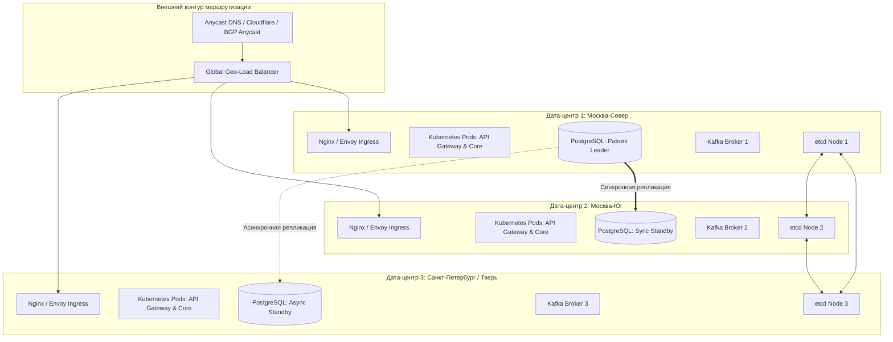

# План аварийного восстановления и отказоустойчивости (High Availability & Disaster Recovery Plan)

## 1. Целевые метрики RPO и RTO

Платформа разделяет данные на 4 класса критичности с жесткими SLA по восстановлению:

| Класс данных | Компоненты | RPO (Max Data Loss) | RTO (Max Downtime) | Механизм защиты |
| :--- | :--- | :--- | :--- | :--- |
| **Tier 0: Критичный (Финансы, Сделки, Заказы)** | PostgreSQL (`orders`, `loads`, `billing`, `etran`) | **RPO = 0** (Нулевая потеря) | **RTO < 60 секунд** | Синхронная репликация Patroni (Multi-AZ) + etcd |
| **Tier 1: Высокий (События, Телеметрия)** | Apache Kafka, Redis (Active Fleet) | **RPO < 5 секунд** | **RTO < 5 минут** | KRaft 3-node cluster, `min.insync.replicas=2` |
| **Tier 2: Средний (Архив треков, Аналитика)** | TimescaleDB, ClickHouse | **RPO < 1 час** | **RTO < 2 часов** | Ежедневные снапшоты + WAL-архивация в S3 |
| **Tier 3: Восстановимый (Поисковые индексы, Кэш)**| OpenSearch, Redis Sessions | **N/A** (Сгенерируемо) | **RTO < 15 минут** | Re-indexing из PostgreSQL через Debezium |

---

## 2. Архитектура распределения по зонам доступности (Multi-AZ Topology)

Система развернута в трех независимых дата-центрах (Москва-Север, Москва-Юг, Санкт-Петербург) с сетевой задержкой между узлами RTT $\le 2.5$ мс:



### Конфигурация PostgreSQL Patroni для гарантии RPO = 0:
```yaml
postgresql:
  parameters:
    synchronous_commit: "on"
    synchronous_standby_names: "FIRST 1 (pg-az2-sync, pg-az3-sync)"
    wal_level: replica
    archive_mode: "on"
    archive_command: "wal-g wal-push %p"
    max_wal_senders: 10
```

---

## 3. Регламент аварийных сценариев

### Сценарий 1: Полный блэкаут Дата-центра 1 (Leader DC Failure)
1. **Автоматическая реакция etcd & Patroni (0..15 сек)**:
   - Лидер в AZ-1 теряет heartbeats в etcd.
   - etcd-кластер фиксирует кворум (2 из 3 нод в AZ-2 и AZ-3 активны).
   - Patroni инициирует автоматический промоушен `pg-az2-sync` в нового Лидера.
2. **Переключение пула соединений (15..30 сек)**:
   - pgBouncer переключает трафик приложений на новый лидер по локальной сети AZ-2.
   - Происходит сброс только незавершенных in-flight транзакций (клиенты получают `ECONNRESET` и делают идемпотентный ретрай).
3. **Обновление DNS / Ingress**:
   - Healthcheck балансировщика снимает AZ-1 с маршрутизации за 5 секунд.
   - **Итоговый даунтайм**: **$< 35$ секунд**, потеря данных: **0 байт**.

### Сценарий 2: Логическое повреждение данных (Ransomware / Некорректная миграция)
Восстановление базы данных до точной секунды перед инцидентом (Point-In-Time Recovery / PITR):

```bash
# 1. Немедленная изоляция: перевод API Gateway в режим "Maintenance Mode"
kubectl scale deployment api-gateway --replicas=0

# 2. Остановка скомпрометированного кластера
patronictl -c /etc/patroni/db.yml pause

# 3. Развертывание чистой ноды из последнего суточного basebackup WAL-G
wal-g backup-fetch /var/lib/postgresql/data LATEST

# 4. Настройка recovery.signal на секунду до аварии (например, 14:22:10)
cat <<EOF > /var/lib/postgresql/data/recovery.signal
recovery_target_time = '2024-03-20 14:22:10+03'
recovery_target_action = 'promote'
restore_command = 'wal-g wal-fetch "%f" "%p"'
EOF

# 5. Запуск PostgreSQL для наката WAL-логов из S3
pg_ctl start -D /var/lib/postgresql/data

# 6. Валидация целостности и снятие режима обслуживания
kubectl scale deployment api-gateway --replicas=6
```

---

## 4. Резервное копирование и изоляция бэкапов (Backup Retention & WORM)

1. **Частота бэкапов**:
   - **Full Basebackup**: Каждую ночь в 02:00 UTC (утилита `wal-g backup-push`).
   - **WAL Streaming**: Непрерывно каждые 60 секунд (или по заполнению сегмента 16 МБ).
2. **Изоляция в S3 (Air-gapped Immutable Storage)**:
   - Бэкапы отправляются в выделенный S3 бакет с политикой **Object Lock в режиме WORM (Write Once, Read Many)** на 90 дней.
   - Даже при компрометации учетной записи администратора удалить или зашифровать резервные копии невозможно.

---

## 5. Регламент регулярных учений (Disaster Recovery GameDay)

- **Периодичность**: 1 раз в квартал в ночное техническое окно.
- **Программа учений**:
  1. Имитация жесткого падения сетевого интерфейса лидера PostgreSQL (`iptables -j DROP`).
  2. Имитация падения брокера Kafka во время пиковой нагрузки телеметрии (20 000 req/sec).
  3. Тестовое развертывание копии базы на резервном стенде из холодного S3-бэкапа с замером фактического RTO по секундомеру.
  4. Формирование отчета аудита для соответствия стандартам ISO 27001 и SOC 2.
