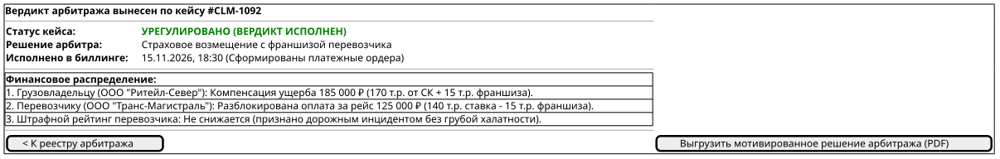

# Поведенческий контракт: Панель арбитража споров и претензий (Dispute Resolution Console)

## 1. Визуальные состояния экрана (PlantUML Salt)

### Состояние 1: Реестр открытых диспутов и претензий (Disputes Queue)
Очередь кейсов по категориям (бой товара, срыв погрузки, простой на складе) с суммами удержанных депозитов и дедлайнами рассмотрения.

### Состояние 2: Таймлайн рейса и сопоставление телеметрии (Incident Timeline Correlation)
Арбитр анализирует сопоставленные данные акселерометра (факт резкого торможения), термограммы рефрижератора, фотоактов и страхового полиса.

### Состояние 3: Вынесение мотивированного вердикта и разблокировка Escrow (Settlement Execution)
Автоматическое распределение удержанных средств между заказчиком, перевозчиком и страховой компанией.

---

## 2. Детальные поведенческие контракты

- **Телематическая экспертиза инцидентов**:
  - Система сопоставляет время фиксации брака с данными черного ящика трекера (акселерометр, резкие маневры, удары с перегрузкой >0.5G).
  - Это исключает необоснованные обвинения перевозчиков при скрытом браке со склада погрузки.
- **Интеграция с Escrow & Ledger**:
  - При утверждении вердикта `BillingService` автоматически выполняет бухгалтерские проводки по счетам эскроу без необходимости ручного формирования платежных поручений.
