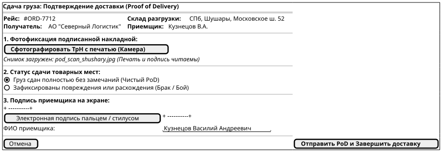
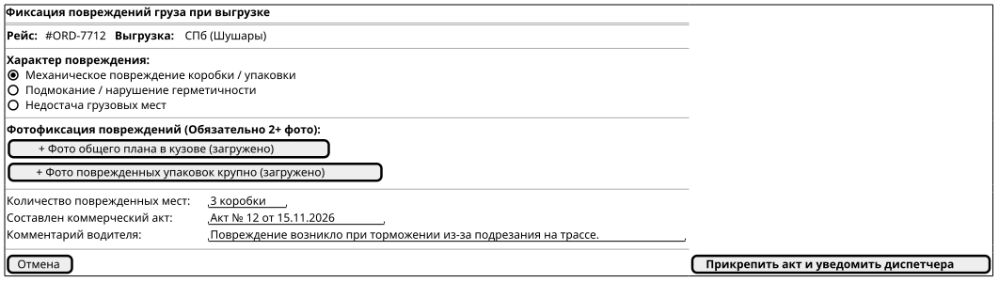
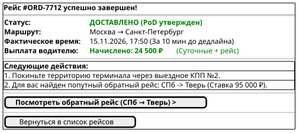

# Поведенческий контракт: Подтверждение доставки и PoD водителем (Driver Delivery & PoD)

## 1. Визуальные состояния экрана (PlantUML Salt)

### Состояние 1: Фотофиксация документов и подпись приемщика (Proof of Delivery Submission)
Водитель фотографирует бумажную ТрН со штампом склада получателя и собирает подпись стилусом на экране смартфона.

### Состояние 2: Регистрация брака или повреждений груза (Damage Exception Report)
При выявлении повреждений упаковки водитель фиксирует фото брака крупным планом и указывает реквизиты составленного коммерческого акта.

### Состояние 3: Завершение рейса и подбор обратной загрузки (Trip Finished & Backhaul)
Рейс переводится в статус `DELIVERED`, водителю начисляется зарплата и предлагается попутный обратный груз (Backhaul Match).

---

## 2. Детальные поведенческие контракты

- **Валидация качества фотоснимка (ML / Client-side check)**:
  - Фотография накладной проверяется на читаемость (разрешение не менее 1920x1080, отсутствие сильного смазывания).
- **Мгновенное уведомление грузовладельца**:
  - При отправке PoD статус заказа меняется на `DELIVERED`, а заказчику отправляется push-уведомление с превью подписанной накладной.
- **Интеграция с рекомендательной системой (Backhaul Engine)**:
  - После закрытия доставки система автоматически запрашивает подходящие грузы из региона выгрузки в сторону домашней базы перевозчика, минимизируя порожний пробег.
