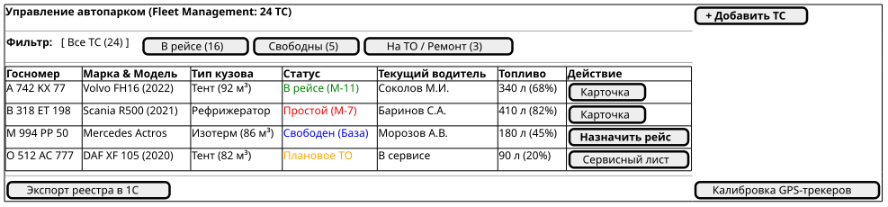
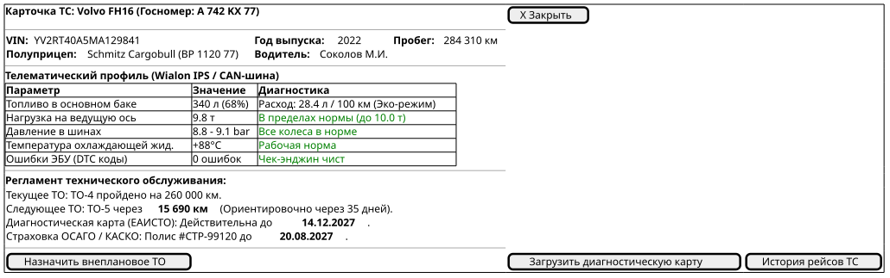
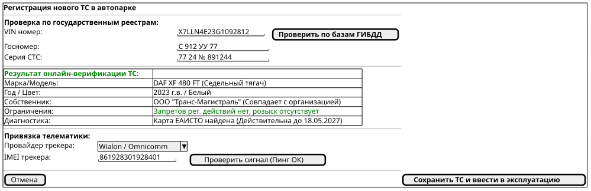

# Поведенческий контракт: Управление автопарком и ТО (Fleet Vehicles Registry)

## 1. Визуальные состояния экрана (PlantUML Salt)

### Состояние 1: Главный реестр ТС со статусами активности (Fleet Overview)
Таблица автопарка с фильтрацией по статусам (в рейсе, свободны, на ТО), остатками топлива и закрепленными водителями.

### Состояние 2: Детальная карточка ТС и телематика (Vehicle Deep Card)
Показания CAN-шины через Wialon IPS (нагрузка на оси, давление в шинах, расход топлива, счетчик ТО).

### Состояние 3: Добавление нового ТС с онлайн-проверкой ГИБДД (Vehicle Onboarding)
Автоматическое заполнение реквизитов по VIN, проверка отсутствия ограничений и привязка GPS-трекера.

---

## 2. Детальные поведенческие контракты

- **Онлайн-валидация через реестры**:
  - При вводе VIN и номера СТС запрос направляется в шлюз проверки автотранспорта.
  - Если обнаружен запрет на регистрационные действия или отсутствие карты техосмотра, кнопка ввода в эксплуатацию блокируется с выводом предупреждения.
- **Интеграция с телематикой Wialon/Omnicomm**:
  - Статус ТС (`IN_TRANSIT`, `IDLE`, `MAINTENANCE`) обновляется автоматически на основе скорости, зажигания и геозоны базы.
- **Контроль регламентного ТО**:
  - При приближении пробега до планового ТО менее 1 000 км диспетчеру выводится напоминание о необходимости планирования сервиса.
